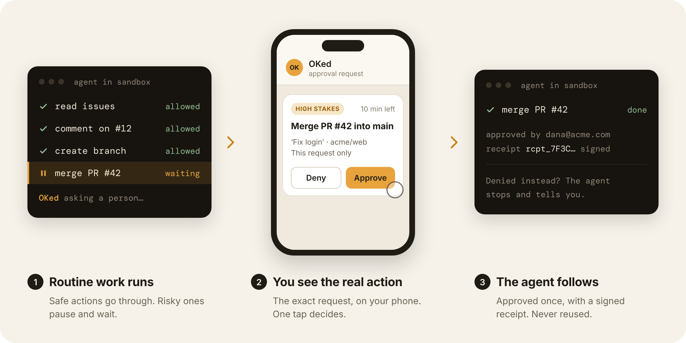
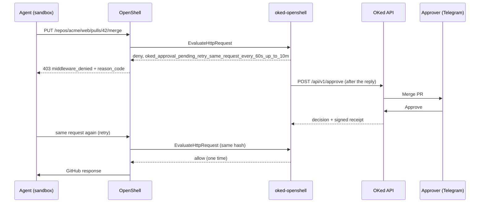

# oked-openshell



Action-specific human approval for agents that run in NVIDIA OpenShell. OKed runs as an
OpenShell supervisor middleware. OpenShell calls it after network policy allows a request
and before OpenShell injects credentials.

Status: early preview. It covers the GitHub REST API. Tested with OpenShell 0.1.2 and 0.1.3.
You need an OKed API key. Step 1 of the quickstart shows how to get one.

## The problem

An agent in a sandbox can call real APIs. OpenShell policy decides which hosts, methods
and paths it can reach, but a rule such as "allow POST to api.github.com" is decided once,
for every request. It cannot tell a comment from a merge into `main`. OKed adds the
missing check: it reads each request as an action with real values, lets routine actions
pass, and asks the right person to approve the one action that matters, for that request only.

## What it does

OpenShell decides which hosts, methods and paths an agent can reach. OKed decides if one
exact action can happen now, with these values. It reads each request as an action, and it
asks the right person only when the action changes something important.

| Request | OKed reads it as | Result |
|---|---|---|
| `GET /repos/acme/web/issues` | `github.read` | Pass (fast path, no network call) |
| `POST /repos/acme/web/issues/1/comments` | Comment on #1 in acme/web | Pass, logged as `warning` |
| `POST /repos/acme/web/git/refs` (new branch) | Create branch fix-login in acme/web | Pass as `warning` (not the default branch) |
| `POST /repos/acme/web/pulls` | Open PR 'Fix login' from fix-login into main in acme/web | Approval (`review`) |
| `PUT /repos/acme/web/pulls/42/merge` | Merge PR #42 'Fix login' into main in acme/web | Approval (`high_stakes`) |
| `DELETE /repos/acme/web/git/refs/heads/old` | Delete branch old in acme/web | Approval (`review`, `high_stakes` on the default branch) |

## How it works: deny and retry

OKed never holds a request. OpenShell opens the upstream connection before it calls the
middleware, and GitHub closes an idle connection after about 5 s. So a hold breaks the request.



1. The agent sends a request. OpenShell policy allows it and calls the middleware.
2. OKed parses the request into an action and gives it a tier. `safe` and `warning` pass.
3. For `review` and `high_stakes`, OKed denies at once with a `reason_code` that tells the
   agent to retry the same request. After the reply, it creates the approval in OKed.
4. The approver decides in Telegram or in the OKed dashboard.
5. The agent sends the same request again. OKed matches it by hash. An approval allows one
   request only. The hash includes the sandbox ID.

Only the `reason_code` reaches the agent. OpenShell drops the free-text `reason`.

| State | `reason_code` |
|---|---|
| Waiting for a person | `oked_approval_pending_retry_same_request_every_60s_up_to_10m` |
| Denied by a person | `oked_denied_by_reviewer_do_not_retry` |
| No decision in 10 minutes | `oked_approval_timed_out_ask_your_user` |
| OKed error | `oked_unavailable_request_blocked` |

## Agent compatibility

Both agents read the reason codes as instructions. Both were tested live through OpenShell,
oked-approval, the OKed backend and Telegram.

| Item | Claude Code | Codex |
|---|---|---|
| Version tested | 2.1.291, model Sonnet | 0.162.1, model `gpt-6.1-sol` |
| Live run with OKed | 2026-10-12: all six demo steps, plus the timed-out code | 2026-10-13: steps 3 to 5 (two PRs approved, two merges denied) |
| Pending code | Retries every 60 s. Without the agent instructions, it stops after 8 to 9 minutes | Retries every 60 s for the full 10 minutes |
| Denied code | Stops and tells the user | Stops and tells the user |
| Timed-out code | Stops and asks for a person | Stops and asks for a person (tested with a test middleware) |
| Calls GitHub with | `curl` | Python `urllib`: the policy must allow `/usr/bin/python3.11` ([policy-codex.yaml](examples/github-demo/policy-codex.yaml)) |
| Setup | Run `deploy/setup-agent.sh <sandbox>` to add the agent instructions | None needed |

The agent instructions are in [deploy/agent-instructions.md](deploy/agent-instructions.md).
With them, Claude Code waits with one tool call per retry and uses the full 10 minutes.
For Codex, each retry is a model call, so a long wait costs more tokens than with Claude Code.

## Pinned OpenShell version

| Item | Value |
|---|---|
| Proto source | `NVIDIA/OpenShell` tag `v0.1.2`, see [proto/VERSION](proto/VERSION) |
| Tested with | OpenShell 0.1.2 and 0.1.3 |
| Docs | `docs.nvidia.com/openshell/0.1.2/` |

The middleware proto did not change from 0.1.2 to 0.1.3. Do not upgrade OpenShell without
a new review of the proto. NVIDIA says the middleware API is still evolving.

## Quickstart (macOS)

**Start oked-openshell first.** The OpenShell gateway does not start when a registered
middleware is not running.

1. Get an OKed API key. Install the OKed CLI (`@oked/claude-code` 0.6.5 or newer) and pair
   this machine:
   ```bash
   npm install -g @oked/claude-code
   oked init --key-only
   ```
   It shows a pairing code and offers to open your browser. Sign in, and the key goes to
   `~/.oked/config.json`. The start script reads it from there. `--key-only` adds no Claude
   Code hook. On a server or over SSH, add `--no-browser` and open the printed link yourself.
2. Install: `npm install`.
3. Put the GitHub token in `~/.config/oked-openshell/env` (`chmod 600`):
   ```
   OKED_GITHUB_READ_TOKEN=...  # fine-grained, read-only "Pull requests" and "Metadata"
   OKED_API_KEY=...            # optional: a key other than the one from `oked init`
   ```
4. Start the service: `deploy/macos/run.sh examples/github-demo/oked-openshell.yaml`.
   To start it at login, run `deploy/macos/install.sh` (launchd agent `ai.oked.openshell`,
   log in `~/Library/Logs/oked-openshell.log`). Run it from a checkout that stays in place,
   not from a temporary worktree: the agent runs the code at that path.
5. Register it in `~/.config/openshell/gateway.toml` (see
   [examples/github-demo/gateway.toml](examples/github-demo/gateway.toml)), then run
   `brew services restart openshell`.
6. Attach it in the sandbox policy and apply with `policy set` (`policy update` cannot change
   middleware): `openshell policy set demo --policy examples/github-demo/policy.yaml --wait`.
7. For Claude Code, add the agent instructions to the sandbox. The script shows the lines and
   asks before it changes anything: `deploy/setup-agent.sh demo`. See
   [Agent compatibility](#agent-compatibility).

The registration uses `allow_insecure_transport = true` on loopback. The gateway warns that
extension authentication is off. This is acceptable on one machine.

### Linux

Linux support is coming. The start script and the login agent in `deploy/macos/` need zsh
and launchd, and they are tested on macOS only.

## Config

`oked-openshell.yaml`, checked with zod at startup. An invalid config stops the service.
Secrets come only from environment variables.

```yaml
name: oked-approval            # the manifest name; use it in gateway.toml
listen: 127.0.0.1:50052
oked:
  api_url: https://api.oked.ai
  api_key_env: OKED_API_KEY
  require_receipt: true        # check the signed receipt before an approval allows a request
github:
  read_token_env: OKED_GITHUB_READ_TOKEN
approval:
  pending_window_minutes: 10
  grant_valid_minutes: 5
  status_check_timeout_ms: 1000
  state_file: ~/.local/state/oked-openshell/retry-state.json   # null: memory only
approvers:
  default: core-team
  sandboxes:                   # sandbox_id or sandbox name -> approver group (sandbox_id wins)
    demo: core-team
  groups:                      # optional: approver group -> OKed API key of the approver
    core-team: { api_key_env: OKED_API_KEY }
rules: []
```

An approver group is an OKed API key. OKed sends the approval to the Telegram account and
dashboard of the operator who owns that key.

### Rules

A rule matches on `host`, `method`, `path` (regex), `operation` (`*` is a wildcard), `kind`,
and field conditions. A matching rule sets the tier, also over the catalog tier. When several
rules match, the highest tier wins.

```yaml
rules:
  - name: protect-main
    host: api.github.com
    when: [{ field: base, op: eq, value: main }]
    tier: high_stakes
  - name: quiet-markdown-render
    method: POST
    path: "^/markdown$"
    tier: safe
```

Conditions: `eq`, `in` (list), `regex`, `gt`, `lt` (number). There is no `eval`.

### Classification order

1. Fast path: a read that no rule matches is `safe`. No network call.
2. GitHub catalog tier. A branch write is `warning` on a feature branch and `review` on the
   default branch. An unknown default branch counts as the default branch.
3. Config rules.
4. OKed classifier (`@oked/sdk`), for GraphQL mutations only: a destructive verb is `high_stakes`.
5. Defaults: a write or an unknown action is `review`. A delete is `high_stakes`.

## OKed backend

The middleware uses the public OKed API.

- `POST /api/v1/approve` creates the approval and sends it to Telegram and the dashboard.
  The middleware calls it after it has replied to OpenShell, and keeps the connection open
  until the decision.
- `GET /api/v1/receipts/:id` is the status read by approval ID.
- The request hash is the receipt nonce. The signed receipt binds to the exact request.
- The operation, kind, resource, request hash, sandbox and scope go with the approval as metadata.

The retry state (request hash, approval ID, status, used) is in a local file,
`approval.state_file` (mode 600). The backend has no lookup by request hash. After a
restart, the middleware reads the file. A pending approval then gets a status check on the
next retry, so a restart never creates a second approval. The file holds no API key.

## Logs

One JSON line per event on stdout. An `evaluate` line has the sandbox, operation, kind,
resource, tier, rule, request hash, approval ID, `retryOf`, decision, `reasonCode`,
receipt ID and latency. The log never has bodies, header values, query values or tokens.

## Known limits

- **OpenShell has no "pending" result.** A middleware can only allow or deny, so OKed denies
  and the agent sends the request again. The upstream proposal for a pending result is
  [NVIDIA/OpenShell#4406](https://github.com/NVIDIA/OpenShell/issues/4406).
- **`git push` is not covered.** It goes to `github.com`, which is L7-opaque: the middleware
  never sees it. The demo profile does not allow `git push`. Agents use the REST API.
- **MCP over HTTP is not parsed.** An MCP request is an opaque write, so it needs approval.
- **`originating_process` is always empty** in this OpenShell version (RFC 0009,
  [NVIDIA/OpenShell#4269](https://github.com/NVIDIA/OpenShell/issues/4269)). Tested with
  OpenShell 0.1.3. OKed routes by `sandbox_id`.
- **No authentication on the extension call** (`allow_insecure_transport`).
- **The retry state is on one machine.** It survives a restart, not a move to another host.
- **Agents differ** (see [Agent compatibility](#agent-compatibility)). An agent that ignores
  the retry code is still blocked. It only stops sooner.

## Develop

```bash
npm test
npm run typecheck
```

## Security

Report security problems privately. See [SECURITY.md](SECURITY.md).

## License

Apache License 2.0, the same license as NVIDIA OpenShell. See [LICENSE](LICENSE). The files in
`proto/` are unchanged copies from NVIDIA OpenShell (see [proto/VERSION](proto/VERSION)).
