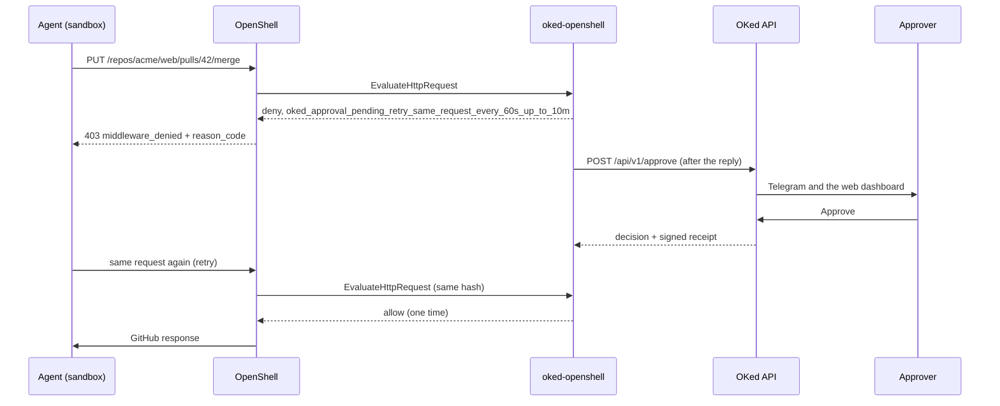

# oked-openshell

[](https://github.com/oked-ai/oked-openshell/actions/workflows/ci.yml)

OKed pauses one risky action from an agent in NVIDIA OpenShell and asks a person for a yes or no on that exact request.


Live approval surfaces are Telegram and the [web dashboard](https://oked.ai/docs). iPhone app coming soon.

OKed is an approval layer for AI agents ([oked.ai](https://oked.ai)). This repository is the OpenShell integration. It is an early preview. The catalog covers GitHub REST calls such as comments, branches, pull requests, merges, and branch deletes. GitHub GraphQL mutations are classified separately, as described below.

## How it plugs into OpenShell

OKed runs as an OpenShell supervisor middleware. OpenShell calls it after network policy allows an HTTP request and before OpenShell injects provider credentials. The service answers allow or deny on `EvaluateHttpRequest` (`PRE_CREDENTIALS`). It does not hold the evaluation open while a person decides.

Register the service in the gateway, then name it from the sandbox policy. The example registration name is `oked-approval`. The service advertises one binding, `http_request_pre_credentials`. It takes no policy `config` object. Settings live in `oked-openshell.yaml`.

OpenShell has no result that means "a person is deciding." The upstream request for that result is [NVIDIA/OpenShell#4406](https://github.com/NVIDIA/OpenShell/issues/4406), and it is still open. Until that exists, OKed denies at once with a `reason_code`, creates the approval after the reply, and allows one identical retry after a yes.

### OpenShell versions

| Item | Value |
|---|---|
| Vendored proto | [proto/VERSION](proto/VERSION), copied from tag `v0.1.2` |
| Same bytes | `v0.1.2` and `v0.1.3` for both proto files |
| Reviewed against | OpenShell `v0.1.6` (released 2026-10-27) |
| Live runs recorded in this repo | OpenShell 0.1.2 and 0.1.3 |

`extension.proto` at `v0.1.6` matches the vendored file. `supervisor_middleware.proto` at `v0.1.4`, `v0.1.5`, and `v0.1.6` adds one comment and does not change the messages. The service already declares protocol 1.0 and the capability `openshell.supervisor-middleware.contract`, which is what that comment documents. This repository has no recorded live run on 0.1.4, 0.1.5, or 0.1.6. NVIDIA still says the middleware API is evolving: expect a review when you upgrade. Docs: [Supervisor Middleware (v0.1.6)](https://docs.nvidia.com/openshell/v0.1.6/extensibility/supervisor-middleware).

## What a request becomes

| Request | OKed reads it as | Result |
|---|---|---|
| `GET /repos/acme/web/issues` | `github.read` | Pass (fast path, no network call) |
| `POST /repos/acme/web/issues/1/comments` | Comment on #1 in acme/web | Pass, logged as `warning` |
| `POST /repos/acme/web/git/refs` (new branch) | Create branch fix-login in acme/web | Pass as `warning` when the branch is not the default branch |
| `POST /repos/acme/web/pulls` | Open PR 'Fix login' from fix-login into main in acme/web | Approval (`review`) |
| `PUT /repos/acme/web/pulls/42/merge` | Merge PR #42 'Fix login' into main in acme/web | Approval (`high_stakes`) |
| `DELETE /repos/acme/web/git/refs/heads/old` | Delete branch old in acme/web | Approval (`review`, `high_stakes` on the default branch) |

A GitHub write that the catalog does not list is an opaque write and defaults to `review`. A delete that the catalog does not list defaults to `high_stakes`. The branch rows assume the default branch is known. The merge row shows the pull request title and branches when the optional GitHub read token is set. Without it, the card shows the repo and the pull request number.

## Quickstart

You need Node.js 22 or newer, an OpenShell gateway, and an OKed API key. [Sign up](https://oked.ai/signup), then pair this machine. The pairing command below needs `@oked/claude-code` 0.6.5 or newer (`--key-only` is in 0.6.5 and in 0.6.20).

**Start oked-openshell before you restart the gateway.** On OpenShell 0.1.6 the gateway still refuses to start when a registered middleware is down.

1. Pair this machine. `--key-only` writes `~/.oked/config.json` and adds no Claude Code hook. On a server or over SSH, add `--no-browser` and open the printed link yourself.

   ```bash
   npm install -g @oked/claude-code
   oked init --key-only
   ```

2. Install this repo: `npm install`.
3. Put secrets in the environment. The macOS start script can load `~/.config/oked-openshell/env` (`chmod 600`, one `NAME=value` per line) and, if `OKED_API_KEY` is still empty, the key in `~/.oked/config.json`. The Node process itself only sees the environment, so on Linux export the key yourself. `OKED_GITHUB_READ_TOKEN` is optional. See [GitHub read token](#github-read-token-optional).

   ```
   OKED_API_KEY=...
   OKED_GITHUB_READ_TOKEN=...  # optional
   ```

4. Start the service.

   macOS, from a checkout that stays in place (a launchd agent keeps running this path):

   ```bash
   deploy/macos/run.sh examples/github-demo/oked-openshell.yaml
   ```

   To start it at login: `deploy/macos/install.sh`. The launchd label is `ai.oked.openshell`. The log is `~/Library/Logs/oked-openshell.log`. `deploy/macos/` uses zsh and launchd and is tested on macOS only.

   Linux and any other host with Node.js 22:

   ```bash
   export OKED_API_KEY=...
   npx tsx src/server.ts examples/github-demo/oked-openshell.yaml
   ```

5. Add the block in [examples/github-demo/gateway.toml](examples/github-demo/gateway.toml) to the gateway config, then restart the gateway.

   On Homebrew, the gateway reads `~/.config/openshell/gateway.toml` when that file exists, and otherwise `$(brew --prefix)/var/openshell/gateway.toml`. Restart with `brew services restart openshell`.

   On the Debian, Ubuntu, Fedora, and RHEL packages, the file is `~/.config/openshell/gateway.toml`. Restart with `systemctl --user restart openshell-gateway`.

   Snap reads `~/snap/openshell/common/.config/openshell/gateway.toml` when that file exists. Restart steps are in the [installation guide](https://docs.nvidia.com/openshell/v0.1.6/about/installation).

   Check the file before you restart:

   ```bash
   openshell-gateway config preflight --path ~/.config/openshell/gateway.toml
   ```

6. OpenShell 0.1.6 does not ship provider profiles inside the gateway. Import the demo profile (id `github-test`) before the sandbox's GitHub provider can use it. The profile allows GitHub REST and GraphQL and does not allow `git push`.

   ```bash
   openshell profile import -f examples/github-demo/profile-github.yaml
   ```

   Create a provider of type `github-test` and attach it to the sandbox. The profile reads `GITHUB_TOKEN` or `GH_TOKEN`. The commands are in the [provider profile guide](https://docs.nvidia.com/openshell/v0.1.6/how-it-works/providers/profiles).

7. Attach the middleware in the sandbox policy. `openshell policy update` cannot change middleware. Use `policy set`:

   ```bash
   openshell policy set demo --policy examples/github-demo/policy.yaml --wait
   ```

   Codex calls GitHub with Python `urllib`, so that sandbox also needs `/usr/bin/python3.11` allowed to `api.github.com`. Use [examples/github-demo/policy-codex.yaml](examples/github-demo/policy-codex.yaml) and a sandbox such as `demo-codex`.

8. For Claude Code, add the agent instructions. The script prints the lines and asks before it writes: `deploy/setup-agent.sh demo`. See [Agents](#agents).

The example registration sets `allow_insecure_transport = true` for plain HTTP on loopback. The gateway then sends no credential and logs a warning that extension authentication is off. That is acceptable on one machine. Use HTTPS for any other deployment. See [Authenticating extensions](https://docs.nvidia.com/openshell/v0.1.6/extensibility/overview#authenticating-extensions).

`gateway.toml` sets `timeout = "2s"` and `max_payload_bytes = 4194304`. The timeout must stay above `approval.status_check_timeout_ms` (default 1000). The platform allows `10ms` through `30s`. The default gateway timeout is `500ms`, which is shorter than the status check, so keep the example value. `4194304` is the 4 MiB limit this service advertises.

## Configuration

`oked-openshell.yaml` is checked with zod at startup. An invalid file stops the process. Secrets come from environment variables, never from the file.

```yaml
name: oked-approval            # ^[a-z][a-z0-9-]*$, default oked-approval
listen: 127.0.0.1:50052        # host:port
oked:
  api_url: https://api.oked.ai
  api_key_env: OKED_API_KEY
  require_receipt: true        # verify the signed receipt before an approval allows a retry
github:
  api_url: https://api.github.com
  read_token_env: OKED_GITHUB_READ_TOKEN
  lookup_timeout_ms: 2000      # 1 to 10000
approval:
  pending_window_minutes: 10   # no decision in this window is a timeout
  grant_valid_minutes: 5       # one retry may use the approval during this window
  status_check_timeout_ms: 1000
  state_file: ~/.local/state/oked-openshell/retry-state.json   # null: memory only
approvers:
  default: core-team           # required
  sandboxes:                   # sandbox_id or sandbox name. sandbox_id wins
    demo: core-team
  groups:                      # optional. A missing group uses oked.api_key_env
    core-team: { api_key_env: OKED_API_KEY }
rules: []
```

`pending_window_minutes` plus `grant_valid_minutes` must be 30 or less. The state file is mode 600. It holds request hashes, approval ids, and status. It holds no API key.

An approver group is an OKed API key. OKed sends the approval to Telegram and the web dashboard of the operator who owns that key.

### GitHub read token (optional)

`github.read_token_env` names the variable that holds a GitHub token. The service starts without it. The `start` log line has `githubEnrichment: false` when the token is absent.

The token belongs to OKed, not to the agent. OKed uses it for two read-only GET calls: the repository, for the default branch, and one pull request, for the title and branches. Use a fine-grained token with read-only "Pull requests" and "Metadata", limited to the repos the agent uses. The token stays in the `Authorization` header. It is not written to logs, errors, receipts, or approval text.

| Lookup | With the token | Without the token |
|---|---|---|
| Default branch | A file write or a branch create on a feature branch is `warning`. A branch delete on a feature branch is `review`. | The default branch is unknown, so a branch write is `review` and a branch delete is `high_stakes`. |
| Pull request | The merge card shows the title and the base and head branches. | The merge card shows the repo and the pull request number. |

The evaluation itself does not wait on GitHub. It uses the cached default branch. When the cache is cold, the first request is denied, the lookup runs after the reply, and the retry passes with no person if the branch does not need approval. A cached value is used for 10 minutes, and the last known value is used for up to 24 hours while a refresh runs. A tag, or any ref outside `refs/heads/`, is `review`.

### Rules

A rule matches on `host`, `method`, `path`, `operation`, `kind` (`read`, `write`, `delete`, `unknown`), and `when` conditions. `host` and `operation` treat `*` as a wildcard. `path` is a regular expression. Every `when` condition must match. A matching rule sets the tier and replaces the catalog tier. When several rules match, the highest tier wins.

```yaml
rules:
  - name: protect-main
    host: api.github.com
    when: [{ field: base, op: eq, value: main }]
    tier: high_stakes
  - name: quiet-markdown-render
    method: POST
    path: "^/markdown$"
    tier: safe
```

Condition operators: `eq`, `in` (a list), `regex`, `gt`, `lt` (a number). There is no `eval`.

### Classification order

1. Fast path. A read that no rule matches is `safe`. No network call.
2. Config rules, when any rule matches.
3. The GitHub REST catalog. A branch write is `warning` on a feature branch and `review` on the default branch. An unknown default branch uses the stricter tier.
4. The OKed classifier (`@oked/sdk`), for a GraphQL mutation that has no catalog entry. The tier is at least `review`. A destructive verb is `high_stakes`.
5. Defaults. A write or an unknown action is `review`. A delete is `high_stakes`.

## Approvals and receipts

Tiers `safe` and `warning` pass. Tiers `review` and `high_stakes` need a person.



1. OpenShell policy allows the request and calls the middleware.
2. OKed parses the request, classifies it, and hashes it.
3. For `review` and `high_stakes`, OKed denies at once. The `reason_code` tells the agent to retry the same request. After the reply, OKed creates the approval.
4. The person decides in Telegram or on the web dashboard. The approval window is 10 minutes (`approval.pending_window_minutes`).
5. The agent sends the same request again. OKed matches the hash. A yes allows one request, and only within `grant_valid_minutes` (default 5) after the decision. A later identical request needs a new approval.

The hash is the hex SHA-256 of these fields joined by newlines: sandbox id, method, lowercased host, path, query, and the hex SHA-256 of the body. The query keeps the order the agent sent. The body is hashed before OpenShell injects credentials.

Only the `reason_code` reaches the agent. OpenShell drops the free-text `reason`. The sandbox sees `error: middleware_denied` and the code. See [Supported operations](https://docs.nvidia.com/openshell/v0.1.6/extensibility/supervisor-middleware/operations).

| State | `reason_code` |
|---|---|
| Waiting for a person | `oked_approval_pending_retry_same_request_every_60s_up_to_10m` |
| Denied by a person | `oked_denied_by_reviewer_do_not_retry` |
| No decision in the pending window | `oked_approval_timed_out_ask_your_user` |
| OKed error, or a receipt that does not verify | `oked_unavailable_request_blocked` |

The pending code is a fixed string. It tells the agent to send the same request again every 60 seconds for up to 10 minutes. The middleware does not enforce that interval. It does enforce `pending_window_minutes`. Leave that value at 10 so the code and the window agree.

The middleware calls the public OKed API:

- `POST /api/v1/approve` creates the approval. The middleware starts it after it has replied to OpenShell, and waits on that call for the pending window plus two minutes.
- `GET /api/v1/pending` finds the approval id for this request hash while that call is open.
- `GET /api/v1/receipts/:id` reads the decision by approval id. A 404 means the approval is still pending.

The request hash is the receipt nonce, so the signed receipt binds to that request. Each decision is an Ed25519 receipt. With `require_receipt: true` (the default), the middleware checks the signature against OKed's published keys before a yes can allow the retry. A failed check denies the request.

Anyone can check a receipt without this service:

- Paste one receipt at [oked.ai/docs#verify](https://oked.ai/docs/#verify). The page checks the signature in the browser.
- Export a bundle from the dashboard and run `npx @oked/verify <export.zip>`.

This service does not write `~/.oked/receipts.jsonl`. The receipt id is on the `evaluate` log line (`receiptId`).

Retry state (request hash, approval id, status, used) is the local file `approval.state_file`. The backend has no lookup by request hash. After a restart, the middleware reads the file. A pending approval gets a status check on the next retry, so a restart does not create a second approval.

### Agents

Recorded live runs, through OpenShell, this middleware, the OKed API, and Telegram:

| Item | Claude Code | Codex |
|---|---|---|
| Version in that run | 2.1.291, model Sonnet | 0.162.1, model `gpt-6.1-sol` |
| Run | 2026-10-12 | 2026-10-13, steps 3 to 5 |
| Pending code | Retries every 60 s. Without the agent instructions, it stops after 8 to 9 minutes | Retries every 60 s for the full 10 minutes |
| Denied code | Stops and tells the user | Stops and tells the user |
| Timed-out code | Stops and asks for a person | Stops and asks for a person |
| Calls GitHub with | `curl` | Python `urllib` |

These rows record those runs.

The instructions are in [deploy/agent-instructions.md](deploy/agent-instructions.md). `deploy/setup-agent.sh <sandbox>` writes them to `/sandbox/CLAUDE.md`. With them, Claude Code waits with one tool call per retry and uses the full 10 minutes. Codex follows the reason codes without the file. For Codex, pass `--agent codex` to write `/sandbox/AGENTS.md`. Each Codex retry is a model call, so a long wait costs more tokens than with Claude Code.

## Logs

One JSON line per event on stdout, with a `ts` field. An `evaluate` line has the sandbox, sandbox id, operation, kind, resource, tier, classification source, the first matching rule, request hash, approval id, `retryOf`, decision, `reasonCode`, `via`, receipt id, and latency. The log has no bodies, header values, query values, or tokens.

## Troubleshooting

**The gateway does not start.** The middleware is not listening, or `Describe` failed. Start oked-openshell first. The `start` log line shows the listen address, the approver groups, and `githubEnrichment`.

**The gateway does not see the registration.** Confirm which file this install reads. Homebrew ignores `~/.config/openshell/gateway.toml` when that file does not exist and uses the prefix path instead. Run `openshell-gateway config preflight` on the file you edited, then restart.

**`policy update` did not attach the middleware.** Middleware changes need `openshell policy set <sandbox> --policy <file> --wait`. See [Manage sandbox policies](https://docs.nvidia.com/openshell/v0.1.6/how-it-works/policies/manage-policies).

**The agent sees `middleware_failed` instead of a reason code.** The gateway `timeout` is shorter than the status check, the process is down, or the payload exceeds `max_payload_bytes`. Keep `timeout` above `approval.status_check_timeout_ms`. The example policy uses `on_error: fail_closed`, so a middleware failure blocks the request.

**The agent stops during the 10 minutes.** It is ignoring the pending `reason_code`. For Claude Code, run `deploy/setup-agent.sh`. The request stays blocked either way.

**Every branch write asks for approval.** `OKED_GITHUB_READ_TOKEN` is unset or cannot read the repo, so the default branch is unknown.

**A yes does not let the retry through.** The retry differed by method, host, path, query, body, or sandbox id, so the hash differs. Or `grant_valid_minutes` has passed. Or `require_receipt` rejected the receipt. The log line `approval_failed` has the error string. A receipt failure uses `oked_unavailable_request_blocked`.

**A restart created a second approval.** The state file was missing, unreadable, or `state_file` was `null`. A file that does not parse is treated as empty, and the log event is `state_file_error`.

### Limits

- **No pending result.** OKed denies and the agent retries. [NVIDIA/OpenShell#4406](https://github.com/NVIDIA/OpenShell/issues/4406) is open.
- **Keep evaluations short.** [NVIDIA/OpenShell#4462](https://github.com/NVIDIA/OpenShell/issues/4462) is open. It reports that a request waiting for an evaluation slot can lose an upstream connection, and that `api.github.com` closes an idle connection after about 5 seconds. This service does GitHub lookups and approval creation after the reply.
- **`git push` is outside this middleware.** The demo profile does not allow `git-receive-pack`, and the policy attaches OKed to `api.github.com` only. The demo uses the REST API.
- **MCP over HTTP is not parsed.** A JSON-RPC body is opaque. A POST is a write, so the default tier is `review` and it needs approval.
- **WebSocket messages are not inspected.** The service does not advertise that binding.
- **`originating_process` is unused here.** Routing uses `sandbox_id`, then the sandbox name, then `approvers.default`. [NVIDIA/OpenShell#4269](https://github.com/NVIDIA/OpenShell/issues/4269) asks OpenShell to populate the field and is still open. Checks recorded in this repo on OpenShell 0.1.3 saw the field empty.
- **Loopback registration disables extension authentication** when `allow_insecure_transport` is true.
- **Retry state is local to one machine.** It survives a restart of this process. It does not follow a move to another host.
- **`binding_policy` can stay at the default, `dynamic`.** This service advertises only `http_request_pre_credentials`. Set `allowlist` with that binding if you want the gateway to require it. `allowlist` and `exact` need a supervisor new enough to enforce them (OpenShell 0.1.6). Older supervisors ignore those fields.

## Develop

```bash
npm test
npm run typecheck
```

CI runs both on Node.js 22 and 24.

## Links

- OKed: [oked.ai](https://oked.ai)
- Docs: [oked.ai/docs](https://oked.ai/docs)
- Verify a receipt: [oked.ai/docs#verify](https://oked.ai/docs/#verify) and `npx @oked/verify`
- Security of the OKed service: [oked.ai/security](https://oked.ai/security)
- Sign up: [oked.ai/signup](https://oked.ai/signup)
- This repository's security reports: [SECURITY.md](SECURITY.md)
- OpenShell 0.1.6 middleware: [docs.nvidia.com/openshell/v0.1.6](https://docs.nvidia.com/openshell/v0.1.6/extensibility/supervisor-middleware)
- Demo files: [examples/github-demo](examples/github-demo/README.md)

## License

Apache License 2.0, the same license as NVIDIA OpenShell. See [LICENSE](LICENSE). The files in `proto/` are copies from NVIDIA OpenShell (see [proto/VERSION](proto/VERSION)).
